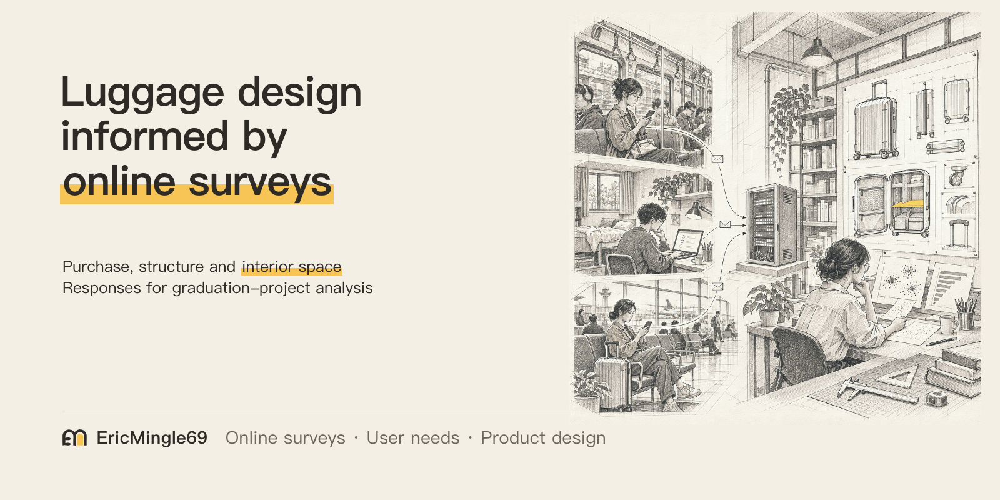

<picture>
  <source media="(prefers-color-scheme: dark)" srcset="readme-assets/cover-en-dark.png">
  
</picture>

<a href="问卷网页/入口界面/index.php">Survey entry source</a> · <a href="问卷网页/问卷模块/主页面/主界面.php">Questionnaire menu</a> · <a href="问卷网页/问卷模块/管理页面/index.php">Administration</a> · <a href="PERSONAL-NOTICE.md">Permissions</a>

  
  
  
  

<a href="README.md">简体中文</a> · <b>English</b>

# Online Luggage Questionnaire System

This project contains the source of an online survey supporting a luggage graduation project. PHP, JavaScript and MySQL collect purchase preferences, usage experiences and interior-space needs. The repository includes a welcome page, basic-information form, three questionnaires, submission handlers and administration pages. Responses are intended for subsequent clustering and needs analysis to inform luggage design.

## Overview

Respondents open a survey link on a phone or computer, read the welcome page, provide basic information and select a questionnaire. Sessions associate their progress across pages. Each submission returns to the questionnaire menu; completing all questionnaires ends the session and returns to the welcome page with a completion message. A thank-you page exists but is not connected to the main flow. Administration is intended to support completion monitoring and data export for researchers; the current dashboard still contains static displays, and the report-export link is a placeholder.

## Design highlights

| Stage | Source and purpose |
| --- | --- |
| Entry and basic information | Welcome page, information form and session setup leading to survey selection |
| Questionnaire 1 | Purchase decisions and basic needs |
| Questionnaire 2 | Structure and usage experience |
| Questionnaire 3 | Interior-space design, including storage and innovation needs |
| Submission and completion | Submission handlers, database-write logic and welcome-page completion message |
| Administration and analysis | Login-related code and dashboard page; export and live statistics still require work |

## Results

The illustration presents the survey-to-design workflow: respondents answer online, submissions reach the system, and researchers analyze needs and sketch luggage designs.

<picture>
  <source media="(prefers-color-scheme: dark)" srcset="readme-assets/survey-dark.png">
  
</picture>

Page implementations are available in the [welcome page](问卷网页/入口界面/index.php), [questionnaire 1](问卷网页/问卷模块/问卷1/questionnaire1.php), [questionnaire 2](问卷网页/问卷模块/问卷2/questionnaire2.php) and [questionnaire 3](问卷网页/问卷模块/问卷3/questionnaire3.php). These links open source files, not a live demo.

## Method

1. Respondents open the welcome page and provide basic information. PHP sessions maintain state across pages.[[1]](#references)
2. Respondents choose among three questionnaires. The frontend collects selections and submits them to PHP handlers.
3. Server code uses MySQLi to connect to the database and process response writes. Each submission returns to the questionnaire menu; completing all questionnaires ends the session and returns to the welcome page with a completion message.[[2]](#references)
4. The intended administrator workflow is to review completion and export data after login. Static dashboard content and placeholder links do not establish that the full workflow is implemented.
5. Responses support graduation-project clustering and needs analysis outside this repository, followed by luggage design. This repository provides no reproducible clustering results or design-validation findings.

Running the source requires a web environment with PHP and MySQLi, a MySQL database, and replacement of connection placeholders in the [database configuration](问卷网页/共用资源/php/db_connect.php). Table definitions and administrator initialization also require review. Opening PHP files directly does not run the survey.

## Limitations

- A complete deployment guide, SQL initialization scripts and validated runtime versions are not provided.
- The dashboard includes static content, and report export is a placeholder. Displayed figures must not be treated as actual survey findings.
- The dashboard lacks server-side login checks. Client-side visibility controls do not prevent direct access to static content in the page source.
- Questionnaire rationale, administrator initialization and response-handling policies need documentation. Runtime behavior and security were not validated during this documentation update.
- Documentation and covers contain no real responses or respondent personal information. Real surveys require defined participant information, access controls and retention policies; development checks should use synthetic data.
- The root source-code license is unspecified. The documentation license grants no new redistribution rights over existing code or third-party assets.

## Acknowledgements

The pages use PHP, MySQL, Bootstrap, jQuery and Font Awesome. Cover illustrations were generated by an image-generation model and processed by this project.

## References

These are official references for interfaces used by the source, not a verified record of citations during original development.

1. PHP Group. PHP Manual: Session Handling. [Official documentation](https://www.php.net/manual/en/book.session.php). Relates to cross-page session management.
2. PHP Group. PHP Manual: MySQL Improved Extension. [Official documentation](https://www.php.net/manual/en/book.mysqli.php). Relates to database access.

## Related research

- Eysenbach, G. (2004). Improving the Quality of Web Surveys: The Checklist for Reporting Results of Internet E-Surveys (CHERRIES). *Journal of Medical Internet Research*, 6(3), e34. [DOI](https://doi.org/10.2196/jmir.6.3.e34). Addresses participation, completion and reporting in online surveys; a reference for subsequent reporting, without claiming that this project implemented the checklist.

## Repository structure

| Path | Contents |
| --- | --- |
| `问卷网页/入口界面/` | Welcome page, basic-information form, administrator login entry and thank-you page |
| `问卷网页/问卷模块/主页面/` | Basic-information confirmation and survey selection |
| `问卷网页/问卷模块/问卷1/` through `问卷3/` | Three questionnaires and associated processing |
| `问卷网页/问卷模块/管理页面/` | Administration dashboard |
| `问卷网页/共用资源/` | CSS, JavaScript, PHP and existing images |
| `readme-assets/` | Covers, workflow illustrations and documentation license |

---

Maintained by <picture><source media="(prefers-color-scheme: dark)" srcset="readme-assets/em-logo-dark.svg"></picture> <b>EricMingle69</b> · <a href="https://github.com/Ming-Sir-69">Ming-Sir-69</a> 
Original documentation expression: MIT. Existing source-code licensing is unspecified; see [permissions](PERSONAL-NOTICE.md).
