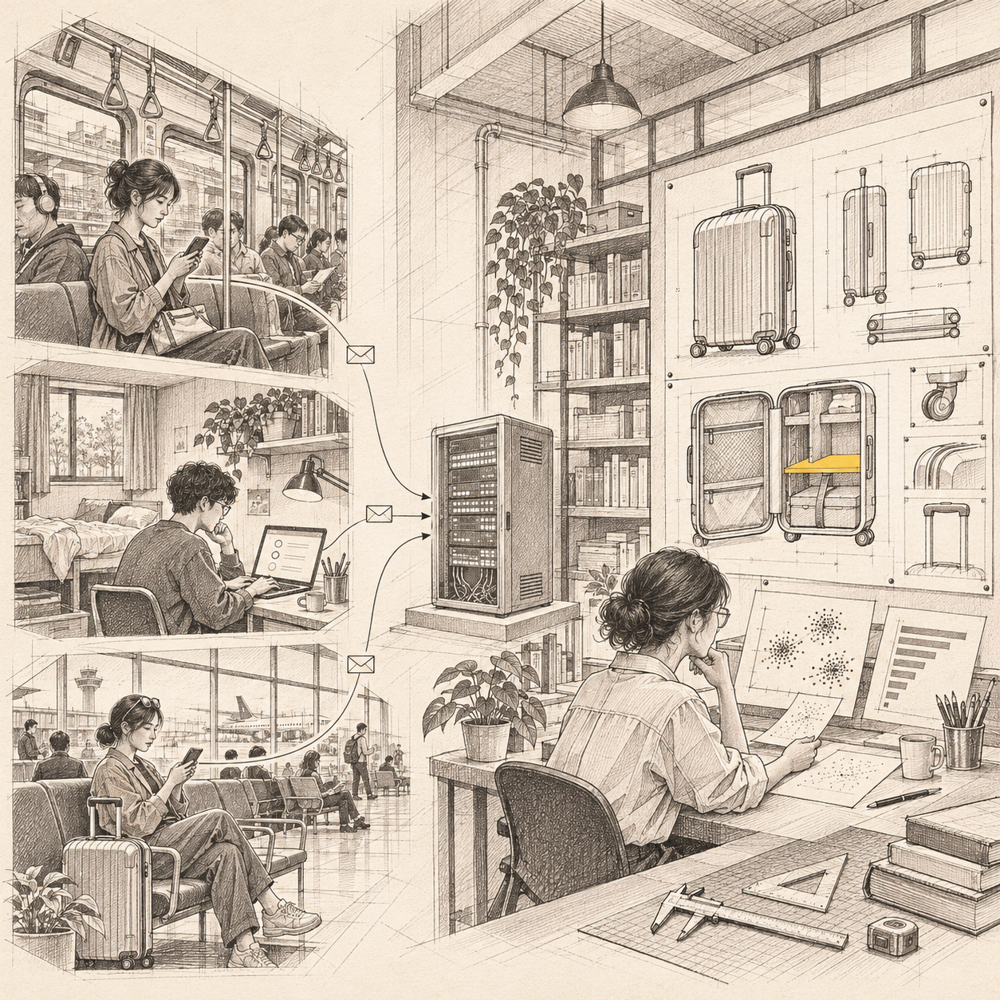

<picture>
  <source media="(prefers-color-scheme: dark)" srcset="readme-assets/cover-zh-dark.png">
  
</picture>

<a href="问卷网页/入口界面/index.php">调研入口源码</a> · <a href="问卷网页/问卷模块/主页面/主界面.php">问卷选择</a> · <a href="问卷网页/问卷模块/管理页面/index.php">管理页面</a> · <a href="PERSONAL-NOTICE.md">许可说明</a>

  
  
  
  

<b>简体中文</b> · <a href="README.en.md">English</a>

# 行李箱线上问卷调研系统

本项目是行李箱毕业设计配套的线上问卷源码，使用 PHP、JavaScript 和 MySQL 收集受访者的购买偏好、使用体验与内部空间需求。仓库包含欢迎页、基本信息表单、三份问卷、提交处理和管理页面；答卷用于后续毕设的聚类与需求分析，形成行李箱设计依据。

## 概述

受访者通过手机或电脑打开调研链接，阅读欢迎页，填写基本信息，再选择问卷作答。系统通过会话关联填写状态。提交后返回问卷选择页；全部完成后结束会话并回到欢迎页显示完成提示。感谢页已存在，但尚未接入主流程。管理端的业务目标是查看完成情况和导出数据，供研究者分析；当前管理仪表盘仍含静态展示，导出报告入口为占位链接。

## 设计要点

| 环节 | 源码内容与用途 |
| --- | --- |
| 入口与基本信息 | 欢迎页、信息表单与会话建立，衔接问卷选择 |
| 问卷一 | 购买决策与基本需求 |
| 问卷二 | 结构与使用体验 |
| 问卷三 | 内部空间设计专项调研，包含收纳与创新需求 |
| 提交与结束 | 提交处理、数据库写入逻辑与欢迎页完成提示 |
| 管理与分析 | 登录相关代码、仪表盘页面；导出与真实统计接入仍需完善 |

## 成果展示

下图表现调研到设计的业务关系：受访者在线填写，答卷汇入系统，研究者分析需求并绘制行李箱方案。

<picture>
  <source media="(prefers-color-scheme: dark)" srcset="readme-assets/survey-dark.png">
  
</picture>

具体页面实现见[欢迎页](问卷网页/入口界面/index.php)、[问卷一](问卷网页/问卷模块/问卷1/questionnaire1.php)、[问卷二](问卷网页/问卷模块/问卷2/questionnaire2.php)与[问卷三](问卷网页/问卷模块/问卷3/questionnaire3.php)。链接指向源码，不是在线演示。

## 方法

1. 受访者打开欢迎页，填写基本信息；PHP 会话维护跨页面的状态。[[1]](#参考文献)
2. 受访者从三份问卷中选择作答，前端收集选择项并提交给 PHP 处理代码。
3. 服务端通过 MySQLi 连接数据库、处理答卷写入。每份问卷提交后返回选择页；全部完成后结束会话，回到欢迎页显示完成提示。[[2]](#参考文献)
4. 管理员登录后的预期工作是查看完成情况、导出数据。当前仪表盘的静态内容和占位入口不代表已实现该完整流程。
5. 数据用于仓库外的毕设聚类与需求分析，再转化为行李箱设计；本仓库不提供可复现的聚类结果或设计验证结论。

运行前需准备支持 PHP 和 MySQLi 的 Web 环境与 MySQL 数据库，并配置[数据库连接](问卷网页/共用资源/php/db_connect.php)中的连接占位值。还需核对表结构及管理员初始化流程。直接打开 PHP 文件不能运行问卷。

## 局限

- 仓库未提供完整部署指南、SQL 初始化脚本或经过验证的运行环境版本。
- 管理仪表盘含静态内容，导出报告是占位链接；不可将页面展示数字视为实际调研结果。
- 管理仪表盘缺少服务端登录校验；客户端显示控制不能阻止直接访问页面源码中的静态内容。
- 问卷设计依据、管理员初始化和答卷处理政策仍需补充；当前源码未经过本轮运行或安全验证。
- 文档与封面不包含真实答卷或受访者个人信息。实际调研需另行明确告知、访问权限和数据保留方式，开发验证使用合成数据。
- 根源码未明确许可；文档许可不授予既有代码或第三方素材的再分发权限。

## 致谢

页面使用 PHP、MySQL、Bootstrap、jQuery 与 Font Awesome。封面插画由图像生成模型生成，经本项目处理。

## 参考文献

以下为源码所用接口的官方文档，不代表已确认原开发过程的引用记录。

1. PHP Group. PHP Manual: Session Handling. [官方文档](https://www.php.net/manual/en/book.session.php)。对应跨页面会话管理。
2. PHP Group. PHP Manual: MySQL Improved Extension. [官方文档](https://www.php.net/manual/en/book.mysqli.php)。对应数据库访问接口。

## 相关研究

- Eysenbach, G. (2004). Improving the Quality of Web Surveys: The Checklist for Reporting Results of Internet E-Surveys (CHERRIES). *Journal of Medical Internet Research*, 6(3), e34. [DOI](https://doi.org/10.2196/jmir.6.3.e34)。对应线上问卷的参与、完成与报告口径；作为后续调研报告的参考，不声称本项目已经按该清单实施。

## 仓库结构

| 路径 | 内容 |
| --- | --- |
| `问卷网页/入口界面/` | 欢迎页与基本信息表单、管理员登录入口、感谢页 |
| `问卷网页/问卷模块/主页面/` | 基本信息确认与问卷选择 |
| `问卷网页/问卷模块/问卷1/` 至 `问卷3/` | 三份问卷页面与相关处理 |
| `问卷网页/问卷模块/管理页面/` | 管理仪表盘页面 |
| `问卷网页/共用资源/` | CSS、JavaScript、PHP 与既有图片 |
| `readme-assets/` | 文档封面、流程插画与文档许可 |

---

文档维护：**✦ EricMingle69** · [Ming-Sir-69](https://github.com/Ming-Sir-69)  
原创文档表达：MIT；既有源码许可未明确，范围见[许可说明](PERSONAL-NOTICE.md)。
